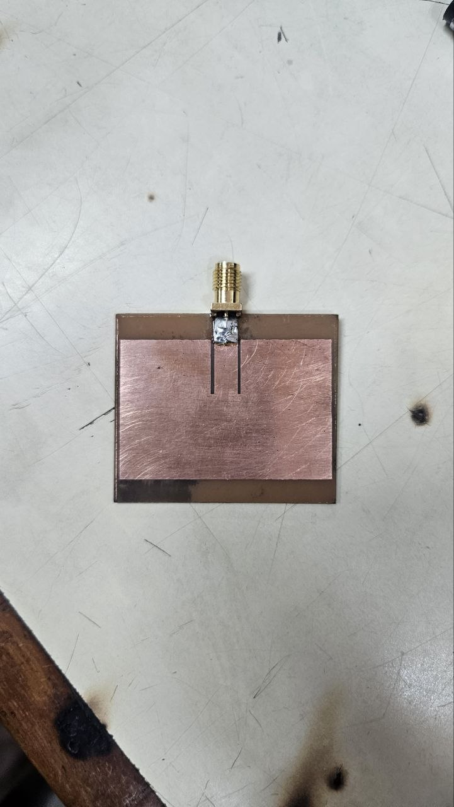
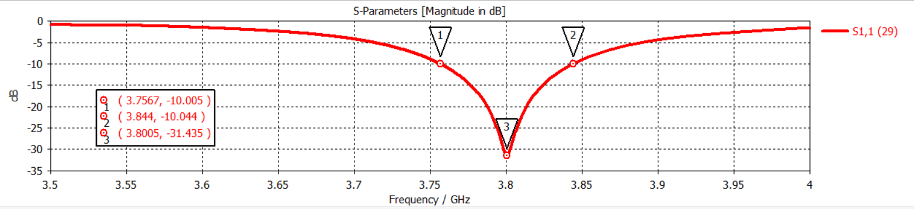
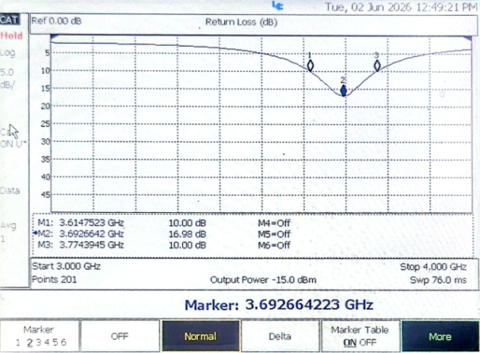
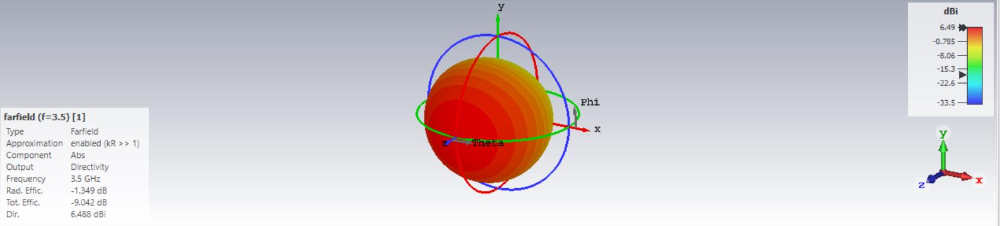
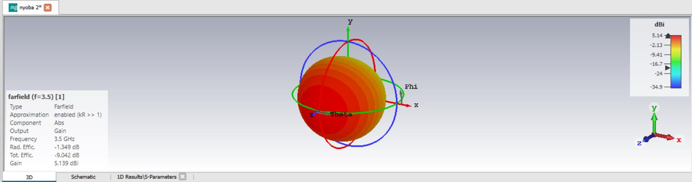

# Design, Optimization, Fabrication, and Measurement of Inset-Fed Microstrip Single Patch Antenna (3.8 GHz) on FR-4 PCB

Repositori ini memuat dokumentasi teknik komprehensif mengenai siklus rekayasa antena gelombang mikro (*microwave antenna engineering*) dari perancangan matematis, pemodelan dan optimasi numerik menggunakan **CST Studio Suite**, proses fabrikasi kimiawi (*wet etching* PCB), hingga pengujian dan validasi parameter frekuensi radio (*RF*) aktual menggunakan **Keysight FieldFox N9917B Microwave Analyzer**.

Proyek praktikum ini diselenggarakan pada mata kuliah *Antena dan Propagasi*, Program Studi D4 Teknik Telekomunikasi, Jurusan Teknik Elektro, **Politeknik Negeri Bandung (POLBAN)**, di bawah bimbingan dosen pengampu:
* **Asep Barnas Simanjuntak, BSEE., M.T.**
* **Hanny Madiawati, S.ST., M.T.**
* **Ir. Enceng Sulaeman, M.T.**

---

## 📌 Abstrak & Alur Proyek

Antena mikrostrip single patch merupakan solusi antena planar yang banyak diimplementasikan pada sistem komunikasi nirkabel modern (termasuk pita frekuensi sub-6 GHz 5G / n78 band) karena profilnya yang ringkas, berbobot ringan, serta mudah diintegrasikan dengan modul sirkuit RF. 

Proyek ini terbagi menjadi dua tahapan rekayasa berkesinambungan:
1. **Fase Perancangan & Simulasi (CST Studio Suite):** Menghitung dimensi transmisi patch, memodelkan struktur inset-feed untuk *impedance matching* $50\ \Omega$, dan mengoptimasi nilai $S_{11}$ dari respon awal $-5,35\text{ dB}$ hingga mencapai $-31,44\text{ dB}$ pada frekuensi target $3,8005\text{ GHz}$.
2. **Fase Realisasi & Pengukuran VNA:** Memindahkan desain ke media fisik PCB FR-4 double-layer melalui metode transfer panas, pelarutan tembaga menggunakan larutan *Ferric Chloride* ($FeCl_3$), perakitan konektor SMA $50\ \Omega$, serta karakterisasi aktual di laboratorium gelombang mikro.

---

## 🔬 Spesifikasi Desain & Perhitungan Analitis

* **Frekuensi Kerja Target ($f_0$):** $3,750\text{ GHz} \le f_0 \le 3,850\text{ GHz}$ (frekuensi tengah: $3,80\text{ GHz}$)
* **Material Substrat:** Epoxy Glass Fiber FR-4 Double Layer
  * Permitivitas Relatif ($\varepsilon_r$): $4,4$
  * Ketebalan Dielektrik ($h$): $1,6\text{ mm}$
  * Faktor Rugi Dielektrik ($\tan\delta$): $0,02$
  * Ketebalan Konduktor Tembaga ($t$): $0,035\text{ mm}$
* **Teknik Pencatuan:** *Inset-Fed Microstrip Line* (kedalaman inset disesuaikan untuk memperoleh titik impedansi masukan $R_{in} \approx 50\ \Omega$ tanpa komponen *matching network* eksternal).

---

## 📊 Komparasi Kinerja: Hasil Simulasi CST vs Pengukuran Aktual VNA

Berdasarkan pengujian laboratorium menggunakan Vector Network Analyzer (VNA) **Keysight FieldFox N9917B** dan **Anritsu Site Master**, diperoleh komparasi performa sebagai berikut:

| Parameter Kinerja | Target Desain | Hasil Simulasi (CST Studio Suite) | Hasil Realisasi Aktual (Keysight VNA) | Status Kelayakan |
|:---|:---:|:---:|:---:|:---:|
| **Frekuensi Resonansi ($f_0$)** | $3,80\text{ GHz}$ | **$3,8005\text{ GHz}$** | **$3,692\text{ GHz}$** | Terverifikasi |
| **Nilai Return Loss ($S_{11}$)** | $\le -10\text{ dB}$ | **$-31,435\text{ dB}$** | **$-16,98\text{ dB}$** | Memenuhi Standar Industri ($\le -10\text{ dB}$) |
| **Lebar Pita (*Bandwidth*)** | $> 50\text{ MHz}$ | **$90\text{ MHz}$** ($3,756 - 3,844\text{ GHz}$) | **$160\text{ MHz}$** ($3,614 - 3,774\text{ GHz}$) | Sangat Baik |
| **Gain / Direktivitas** | $> 3\text{ dBi}$ | **$5,319\text{ dBi}$** / $6,488\text{ dBi}$ | *Diverifikasi pola medan jauh* | Optimal |

---

## 📸 Galeri Realisasi Fisik & Pengukuran Laboratorium

<p align="center">
  
  <br/>
  <em>Gambar 1: Prototipe fisik antena mikrostrip single patch dengan inset-feed dan konektor edge-mount SMA pada substrat PCB FR-4.</em>
</p>

<p align="center">
  
  
  <br/>
  <em>Gambar 2: Perbandingan kurva respon parameter S11 antara hasil simulasi CST Studio Suite (-31,44 dB pada 3,80 GHz) dan hasil pengukuran aktual Keysight FieldFox VNA (-16,98 dB pada 3,69 GHz).</em>
</p>

<p align="center">
  
  
  <br/>
  <em>Gambar 3: Karakteristik pola radiasi 3D medan jauh (Farfield): Direktivitas sebesar 6,488 dBi dan Gain sebesar 5,319 dBi.</em>
</p>

---

## 📈 Analisis Pergeseran Frekuensi & Toleransi Fabrikasi

Hasil pengukuran fisik menunjukkan pergeseran frekuensi resonansi dari $3,80\text{ GHz}$ pada simulasi menjadi $3,692\text{ GHz}$ pada hasil realisasi aktual. Analisis rekayasa menyimpulkan bahwa deviasi tersebut dipengaruhi oleh:
1. **Toleransi Dimensi Saat Etching (*Over-etching / Under-etching*):** Pengikisan larutan $FeCl_3$ menyebabkan variasi mikrometer pada lebar celah inset dan panjang efektif patch ($L_{eff}$).
2. **Dispersi Permitivitas Substrat Komersial:** Nilai $\varepsilon_r$ substrat FR-4 pabrikan komersial umumnya memiliki variasi toleransi berkisar antara $4,2$ hingga $4,6$ pada spektrum gelombang mikro.
3. **Efek Parasitik Konektor & Solder:** Penambahan timah solder pada antarmuka konektor SMA dengan saluran pencatu menimbulkan induktansi parasitik kecil yang sedikit menggeser frekuensi resonansi ke bawah.

Meskipun terjadi pergeseran frekuensi, nilai return loss aktual sebesar **$-16,98\text{ dB}$** (daya pantul $< 2\%$) dan bandwidth operasional **$160\text{ MHz}$** membuktikan bahwa antena telah terpasang dengan *impedance matching* yang baik dan berfungsi secara efektif.

---

## 📂 Struktur Repositori

```text
├── docs/                                          # Dokumen laporan resmi praktikum
│   ├── 01_Perancangan_Antena_Mikrostrip_CST_Kelompok05.pdf   # Laporan perancangan & optimasi CST
│   └── 02_Realisasi_dan_Pengukuran_Antena_PCB_Kelompok02.docx # Laporan fabrikasi PCB & VNA
├── calculations/
│   └── antenna_design_calc.py                     # Skrip kalkulasi dimensi patch & inset feed
├── assets/
│   ├── simulation/                                # Grafik hasil simulasi numerik CST
│   │   ├── 01_s11_awal_sebelum_optimasi.png       # Respon S11 awal (-5.35 dB)
│   │   ├── 02_s11_setelah_optimasi_3.8ghz.png     # Respon S11 optimal (-31.44 dB)
│   │   ├── 03_farfield_directivity_3d.png         # Pola radiasi 3D direktivitas
│   │   └── 04_farfield_gain_3d.png                # Pola radiasi 3D gain antena
│   ├── fabrication/                               # Dokumentasi tahapan fabrikasi hardware
│   │   ├── 01_tahapan_fabrikasi_etching.png       # Alur transfer pola & pelarutan kimia
│   │   ├── 02_antena_tampak_depan_belakang.jpeg   # Foto fisik antena depan dan belakang
│   │   └── 03_antena_realisasi_fisik_sma_detail.jpg # Foto makro prototipe antena & konektor SMA
│   └── measurement/                               # Dokumentasi pengukuran instrumen RF
│       ├── 01_keysight_fieldfox_vna_setup.jpeg    # Pengukuran dengan Keysight FieldFox N9917B
│       ├── 02_s11_fieldfox_measurement_curve.jpeg # Kurva S11 terukur pada layar VNA
│       └── 03_tabel_komparasi_simulasi_realisasi.jpeg # Data komparasi parameter terukur
└── README.md
```

---

## 🛠️ Reproduksi Perhitungan Parameter Desain

Untuk memverifikasi dimensi fisik patch, saluran pencatu, dan ground plane secara teoritis, jalankan skrip Python yang tersedia:

```bash
python calculations/antenna_design_calc.py
```

Skrip akan mengevaluasi persamaan saluran transmisi (*Transmission Line Model*) untuk menghitung lebar patch ($W$), panjang efektif ($L_{eff}$), pertambahan panjang akibat medan fringing ($\Delta L$), serta panjang patch aktual ($L$).
